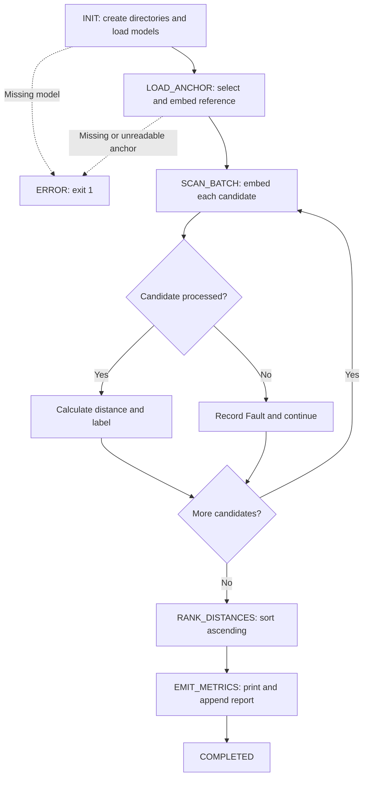

# Matching image-comparison program

This program compares one reference image—the **anchor**—with each image in a
candidate batch. It extracts a normalized feature vector from each image,
calculates its distance from the anchor vector, and produces a ranked report.

The executable entry point is `matching/state_machine.py`. The active GitHub
Actions workflow is `.github/workflows/signal_alignment.yml`.

## Run a comparison

1. Put exactly one readable reference image in `matching/datasets/anchor/`.
   Put the candidate images in `matching/datasets/telemetry_batch/`.
   Commit the inputs to the repository default branch, currently `main`.
2. Open a **new** repository issue titled exactly `matching-trigger`.
3. Read the result in the issue comment, Actions summary, or uploaded
   `matching-comparison-report` artifact.

The title is case-sensitive. The issue body is not parsed for settings.
Editing or reopening an existing issue does not start a comparison.
The workflow comments on and closes the trigger issue even when comparison
fails, provided its final reporting step can complete.

**Current input state, checked October 12, 2026:** the candidate directory
contains `signal_001.jpg` through `signal_028.jpg`. The anchor directory contains
only `.gitkeep`. A reference image still needs to be supplied; without it, the
program fails at `LOAD_ANCHOR`.

## Files and runtime inputs

| Path | Role |
| --- | --- |
| `matching/state_machine.py` | Comparison state machine and vector adapter |
| `.github/workflows/signal_alignment.yml` | Resolve/build the runtime, run comparison, and publish the report |
| `matching/Dockerfile.runtime` | Build the dependency/model runtime image |
| `matching/requirements.txt` | Dependency requirements used by the comparison workflow's image build |
| `matching/wheels/*.whl` | Offline wheel archive used when that workflow rebuilds its image |
| `matching/models/spatial_detector.onnx` | Locate a region in each image |
| `matching/models/feature_encoder.onnx` | Extract the feature vector |
| `matching/datasets/anchor/` | Reference image |
| `matching/datasets/telemetry_batch/` | Candidate images |
| `matching/metrics.md` | Default generated comparison report |

Runtime Python packages are ONNX Runtime, NumPy, and Pillow. Both ONNX files must
be real model bytes, not unresolved Git LFS pointers. The comparison script
does not download dependencies or models itself.

Keep the dataset directories limited to readable image files. The scanner is
not recursive and does not filter by image extension or check whether an entry
is a regular file before trying to open it. The glob excludes hidden dotfiles,
and the code also excludes filenames ending in `.gitkeep`.

## What happens inside the program

`PipelineState` defines the execution states. `VectorSignalPipeline` owns paths,
the anchor vector, candidate results, and the report. `VectorAdapter` owns the
detector and encoder ONNX sessions.



ONNX session-construction exceptions can terminate initialization directly;
they are not all converted into the explicit `ERROR` state.

### Anchor selection

The program takes the first eligible path returned by `glob` in the anchor
directory. It does not choose the newest image or sort paths before selection.
Selection is therefore not deterministic when multiple anchors exist.
Use exactly one anchor image with the current implementation.

The program computes the anchor vector once and compares every candidate to it.
It does not compare all candidates with one another or choose an anchor from
the candidate batch.

### Region detection

For every image, the adapter:

1. Opens the file and converts it to RGB.
2. Resizes it to 320 × 240 for the detector.
3. Converts pixels to float32 and normalizes them as `(pixel - 127) / 128`.
4. Runs the detector and selects the box with the highest class-1 confidence.
5. Accepts that box when confidence is at least 0.65 and the clamped crop is
   at least 10 pixels wide and high.

If the selected region is rejected, the encoder receives the whole image.
The code selects one region; it does not process every detected region.
It crops and resizes, without landmark-based alignment.

### Feature extraction

The selected crop, or whole-image fallback, is resized to 112 × 112.
Pixels become float32, are arranged as a channels-first tensor, and are
normalized as `(pixel - 127.5) / 128`. The encoder's first output is flattened.
The resulting vector is divided by its Euclidean norm when that norm is positive.

### Distance and classification

For each candidate, the program calculates:

```text
distance = Euclidean norm(anchor_vector - candidate_vector)
```

| Condition | Report status | Coherent flag |
| --- | --- | --- |
| Distance strictly less than 0.65 | `PASSED` | `TRUE` |
| Distance 0.65 or greater | `DIVERGENT` | `FALSE` |
| Candidate processing raises an exception | `Fault: <error>` | `FALSE` |

The detector confidence cutoff and vector-distance cutoff both currently use
0.65, but they are separate values serving different purposes. They are
hardcoded in Python, not supplied by the issue or operation config.

Lower distance ranks earlier. A fault uses an internal distance sentinel of
999.0 and displays `N/A` in the report. Candidate faults do not stop the batch.

The labels express the code's similarity threshold. They are not a calibrated
identity probability or a verified identity conclusion. Whole-image fallback,
multiple subjects, crop quality, and the selected models can materially affect
the distance.

## How the GitHub workflow supplies the runtime

The comparison job runs only for the exact `matching-trigger` issue title.

1. Check out the default-branch program and images with automatic LFS smudging disabled.
2. Explicitly pull LFS model and wheel files. The current workflow requires at
   least ten wheel files and model files larger than one million bytes.
3. Authenticate to GitHub Container Registry.
4. Calculate a build-input fingerprint from the Dockerfile, requirements,
   models, and wheel-directory contents.
5. Pull `ghcr.io/bestnameyet/statemachines-matching-runtime:py310`. Reuse it
   only when its embedded fingerprint matches. Otherwise build and push a
   replacement using the repository inputs.
6. Resolve the image's immutable digest and record its provenance in the summary.
7. Run that digest with the repository mounted at `/repo`. Copy its packaged
   model bytes into the checkout's `matching/models/` directory, then execute
   `python matching/state_machine.py`.
8. Publish the report and close the trigger issue.

Concurrent comparison jobs are serialized. Rebuilds require package-write
permission; issue reporting requires issue-write permission. The workflow's
registry location is currently hardcoded to the original repository owner/name.

## Reports and exit behavior

The Markdown report includes the anchor basename, candidate count, threshold,
and a table with rank, candidate filename, vector distance, coherent flag, and status.

The script prints transitions and the report to stdout. It appends the report
to `GITHUB_STEP_SUMMARY` when that environment variable is set; otherwise it
appends to `matching/metrics.md`. Repeated local runs can append multiple reports
to the same file.

The workflow sets the container's report path to `/repo/matching/metrics.md`,
copies that file to the real Actions summary, uploads it as an artifact, and
includes it in the issue comment. It does not commit the metrics report.

| Situation | Current behavior |
| --- | --- |
| Missing model file | Explicit pipeline error and exit 1 |
| Invalid model/session initialization | Exception can terminate execution |
| Missing anchor | Explicit pipeline error and exit 1 |
| Anchor decode or embedding failure | Explicit pipeline error and exit 1 |
| Empty candidate batch with a valid anchor | Report with zero candidates |
| Candidate decode or embedding failure | Fault row; continue processing |
| All candidates fault | Batch can still complete; inspect the rows |
| Report-file write failure | Print a notice and still transition to COMPLETED |

A successful process exit therefore establishes that the pipeline completed,
not that every candidate passed or that the report file was successfully written.

## Run directly

From the repository root, with dependencies installed and real models and images
at the listed paths:

```bash
python matching/state_machine.py
```

The script's CLI has no arguments for the anchor, threshold, or mode.
`VectorSignalPipeline(base_dir=...)` accepts another base directory when called
from Python, but the command-line entry point uses `matching`.

## Relationship to the build bootstrap

See [README_BUILD.md](README_BUILD.md) for the shared Normal/Test runtime builder,
and [Matching_Build_Bootstrap.zip](Matching_Build_Bootstrap.zip) for its source bundle.

The build bootstrap and the comparison workflow are separate execution paths.
The bootstrap's `operation_config.json` selects Normal/Test build isolation.
It does not select the comparison program's inputs or threshold.
The bootstrap builds and verifies a host-local image; it does not publish it
or trigger comparison. The existing comparison workflow uses its own GHCR/LFS
runtime resolution and rebuild logic.

Test bootstrap images place models under `/workspace/matching_test/models/`.
The current comparison workflow expects `/workspace/matching/models/`.
It is not automatically wired to consume those test images.

## Other configuration and retained files

`matching/runtime_config.json` belongs to a separate persistence-test job in
`signal_alignment.yml`. A push changing that file runs the persistence job;
its `mode: test` invokes `matching/test_persistence.py`. It does not start the
issue-triggered comparison or select the bootstrap mode.

The persistence script is not part of comparison execution. Its current
`inputs()` check applies a 10,000-byte minimum to every required file, including
the much smaller Dockerfile and requirements file. Those inputs fail that check;
do not interpret this auxiliary test as a validated comparison startup path.

`matching/trigger.json` is legacy and is not read by the active comparison job.
`matching/Signal_matching_dataset.zip` is a retained source archive; comparison
uses the extracted candidate images. `matching/obsolete/bootstrap.py` is not
the active comparison entry point.

This README describes source behavior reviewed on October 12, 2026. Writing it
does not execute a comparison or validate its similarity threshold.
